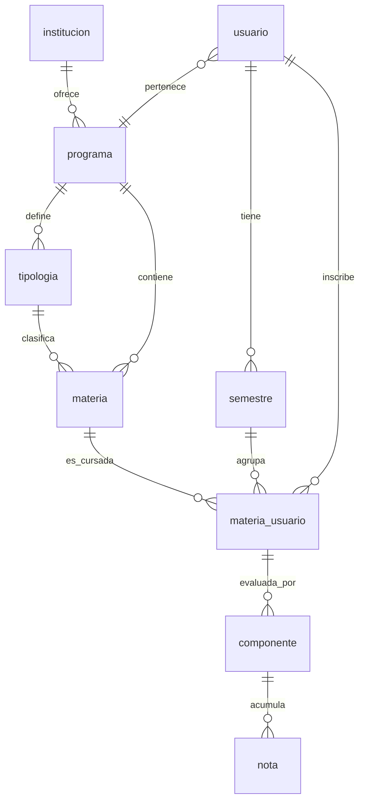

# Diseño — UniGrades Web (MVP)

## Visión general
Aplicación web Next.js (App Router, TypeScript) desplegada en Vercel, con Supabase
(Postgres + Auth) como backend. Patrón de navegación tipo Framer: landing pública en `/`,
aplicación bajo `/app`. Las reglas de negocio viven en Postgres (constraints, triggers,
vistas, RLS). El frontend usa una capa de servicios tipada sobre el cliente Supabase y
React Query para la gestión de datos remotos. UI mínima blanco/negro.

## Arquitectura
```mermaid
graph TD
    A[Next.js App Router - Vercel] -->|React Query + supabase-js| B[Supabase]
    A --> L[Landing publica /]
    A --> P[App protegida /app/*]
    MW[middleware.ts] -->|protege /app/*| A
    B --> C[Supabase Auth - Email + Google]
    B --> D[Postgres]
    D --> E[Tablas del modelo relacional]
    D --> F[Triggers: suma 100%, transiciones estado]
    D --> G[Vistas: promedios materia/semestre/global]
    D --> H[RLS: aislamiento por usuario con auth.uid()]
```

## Estructura de carpetas (propuesta)
```
app/
  layout.tsx                 # layout raíz (providers: React Query, i18n)
  page.tsx                   # landing /
  login/page.tsx
  signup/page.tsx
  app/
    layout.tsx               # layout protegido (verifica sesión, shell de la app)
    page.tsx                 # dashboard
    onboarding/page.tsx
    semesters/page.tsx
    semesters/[id]/page.tsx
    subjects/[id]/page.tsx
    settings/page.tsx
components/
  ui/                        # Button, Input, Container (tontos, blanco/negro)
lib/
  supabase/
    client.ts                # cliente browser
    server.ts                # cliente server (RSC / route handlers)
  i18n/                      # config next-intl + mensajes es/en
services/                    # capa de datos tipada (programas, semestres, materias, notas...)
types/                       # tipos del dominio + tipos generados de Supabase
middleware.ts                # protección de /app/*
supabase/
  migrations/                # SQL versionado (esquema, triggers, vistas, RLS, seed)
messages/
  es.json
  en.json
```

## Modelo de datos


### Entidades (columnas principales)
- **institucion**: id, nombre.
- **programa**: id, institucion_id (FK), nombre, es_publico (si viene del catálogo o fue
  creado por un usuario).
- **tipologia**: id, programa_id (FK), nombre, cuenta_promedio (bool/int — RN-6).
- **materia**: id, programa_id (FK), tipologia_id (FK), nombre, creditos, codigo.
- **usuario**: id (= auth.uid()), programa_id (FK NOT NULL — RN-1), email, idioma,
  onboarding_completo.
- **semestre**: id, usuario_id (FK), etiqueta (p. ej. "2024-2"), orden.
- **materia_usuario**: id, usuario_id (FK), materia_id (FK), semestre_id (FK),
  estado (CHECK: en_curso|aprobada|reprobada|retirada — RN-4).
  UNIQUE(materia_id, semestre_id) por usuario (RN-3).
- **componente**: id, materia_usuario_id (FK), nombre, porcentaje (RN-2 vía trigger).
- **nota**: id, componente_id (FK), valor (CHECK 0.0–5.0 — RN-5), etiqueta, fecha.

### Reglas en la base de datos
- **RN-1**: `usuario.programa_id` NOT NULL + FK.
- **RN-2**: trigger `AFTER INSERT/UPDATE/DELETE` sobre `componente` que valida que la suma
  de `porcentaje` por `materia_usuario_id` sea 100 al confirmar (o función de validación
  invocada al guardar el set completo).
- **RN-3**: `UNIQUE(materia_id, semestre_id)` en `materia_usuario`.
- **RN-4**: `CHECK (estado IN (...))` + trigger que impide transición desde
  aprobada/reprobada hacia en_curso.
- **RN-5**: `CHECK (valor >= 0.0 AND valor <= 5.0)` en `nota`.
- **RN-6**: columna `tipologia.cuenta_promedio`; las vistas de promedio filtran por ella.
- **RN-7**: vista `componente_calificacion` = AVG(nota.valor) por componente.
- **RLS**: políticas en tablas de usuario usando `auth.uid() = usuario_id` (directa o vía
  join).

### Vistas analíticas
- `v_componente_calificacion`: promedio de notas por componente (RN-7).
- `v_materia_promedio`: nota de la materia = Σ(calificación_componente × porcentaje/100).
- `v_semestre_promedio`: promedio ponderado por créditos del semestre, excluyendo
  nivelación (RN-6).
- `v_promedio_global`: promedio ponderado acumulado, excluyendo nivelación (RN-6).

## Autenticación y protección de rutas
- Supabase Auth con proveedores Email/Password y Google OAuth.
- `middleware.ts` intercepta `/app/*`: si no hay sesión válida → redirect a `/login`.
- Al registrarse, se crea la fila `usuario`; si `onboarding_completo = false`, el layout de
  `/app` redirige a `/app/onboarding`.
- Clientes Supabase separados: browser (componentes cliente) y server (RSC/route handlers)
  usando `@supabase/ssr`.

## Capa de servicios (frontend)
- Módulos en `services/` por agregado: `programs`, `semesters`, `subjects`, `components`,
  `grades`, `profile`.
- Cada módulo expone funciones tipadas (p. ej. `listSemesters()`, `createSemester()`),
  que son consumidas por hooks de React Query. Los componentes de UI nunca llaman a
  Supabase directamente.

## Internacionalización
- `next-intl` con mensajes en `messages/es.json` y `messages/en.json`.
- Idioma preferido persistido en `usuario.idioma` (y/o cookie) y aplicado en landing y app.

## UI mínima
- Componentes en `components/ui/`: `Button` (negro, texto blanco), `Input`, `Container`.
- Tokens de estilo centralizados para que un rediseño futuro sea un cambio aislado.

## Testing y verificación
- Type-check (`tsc --noEmit`), lint (ESLint) y build (`next build`) tras cada cambio.
- Tests de lógica de servicios y de reglas de base de datos (casos que violan RN-2..RN-5
  deben fallar; casos válidos pasan).
- Hooks de Kiro: lint/type-check al guardar `.ts/.tsx`.

## Despliegue
- Vercel conectado al repo; variables de entorno `NEXT_PUBLIC_SUPABASE_URL` y
  `NEXT_PUBLIC_SUPABASE_ANON_KEY` (y claves server donde aplique).
- Dominio Vercel actual `unigrades-project.vercel.app`; migración a `.com` futura.

## Decisiones y alternativas
- **Next.js sobre Expo** para la web: mejor para Vercel, SEO de landing y el patrón de
  rutas; el móvil irá en repo separado con Expo compartiendo la misma DB.
- **Reglas en Postgres** (no solo frontend): la base de datos es la autoridad; el frontend
  valida para UX. Esto protege la integridad aunque cambie el cliente.
- **next-intl** para i18n por su integración nativa con App Router.
- **Sin suscripciones** en el esquema del MVP; se añadirán después sin romper el modelo.
